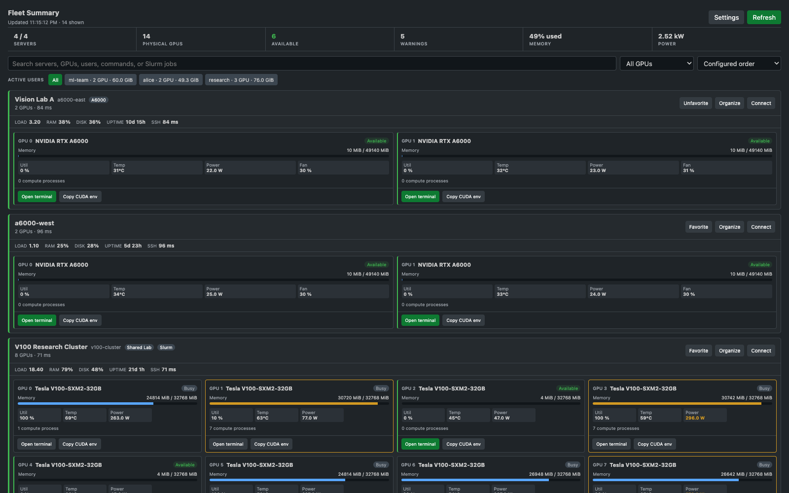

# GPU Fleet Viewer

[](https://github.com/yruichen/gpu-fleet-viewer/actions/workflows/ci.yml)
[](https://marketplace.visualstudio.com/items?itemName=yruichen.gpu-fleet-viewer)
[](https://marketplace.visualstudio.com/items?itemName=yruichen.gpu-fleet-viewer)
[](https://github.com/yruichen/gpu-fleet-viewer/releases/latest)
[](LICENSE.txt)

A fast, privacy-friendly research workstation for finding, understanding, and using NVIDIA GPUs across SSH servers without leaving VS Code.



## Highlights

- Find available GPUs across every configured SSH host with explainable availability rules.
- Search and filter by server, GPU model, user, process command, or Slurm job.
- Responsive server bands and independent process inspectors for dense 8-GPU machines.
- GPU utilization, memory, temperature, power draw/limit, and fan speed.
- Click-to-inspect process details: owner, PID, full command, runtime, GPU memory, and optional Slurm job.
- One-click research terminals with a stable GPU UUID in `CUDA_VISIBLE_DEVICES`; commands are prepared but never auto-executed.
- Lightweight host health for CPU load, RAM, root disk, uptime, and SSH latency.
- Local server aliases, groups, favorites, and duplicate physical-host detection.
- Configurable metrics, warning thresholds, notifications, refresh interval, and SSH timeout.
- Available-GPU count in the VS Code status bar.
- Direct **Connect SSH** action for Remote - SSH users.
- High-performance SSH snapshots, bounded concurrency, hidden-panel pausing, cached Slurm metadata, duplicate-query suppression, and overlapping-refresh protection.
- No telemetry and no stored passwords or private keys.

## Requirements

- VS Code 1.80 or newer.
- `ssh` available on the computer running VS Code.
- `nvidia-smi` installed on each monitored server.
- Non-interactive SSH authentication, normally an SSH key and `BatchMode=yes` compatibility.
- Optional: [Remote - SSH](https://marketplace.visualstudio.com/items?itemName=ms-vscode-remote.remote-ssh) for the **Connect SSH** button.

## Install

Install [GPU Fleet Viewer from the Visual Studio Marketplace](https://marketplace.visualstudio.com/items?itemName=yruichen.gpu-fleet-viewer), search for `GPU Fleet Viewer` in the VS Code Extensions view, or run:

```bash
code --install-extension yruichen.gpu-fleet-viewer
```

For offline installation, download the latest `.vsix` from [GitHub Releases](https://github.com/yruichen/gpu-fleet-viewer/releases/latest), then run:

```bash
code --install-extension gpu-fleet-viewer-1.1.0.vsix
```

Reload VS Code and open **GPU Fleet** from the Activity Bar.

## Configure servers

The extension discovers concrete hosts from `~/.ssh/config`; wildcard entries are ignored. A minimal entry looks like this:

```sshconfig
Host gpu-node-01
    HostName 192.0.2.10
    User researcher
    IdentityFile ~/.ssh/id_ed25519
```

You can also run **GPU Fleet Viewer: Add Server** and enter an SSH alias, hostname, IP address, or `user@host`. Use **Configure Servers** from the view toolbar to hide hosts you do not want to monitor.

## Research workflow

1. Run **GPU Fleet Viewer: Find Available GPU**, or filter the dashboard to **Available**.
2. Review the availability explanation, free memory, host health, and active users.
3. Select **Open terminal**. The extension creates an integrated terminal and prepares an SSH command that exports `CUDA_DEVICE_ORDER=PCI_BUS_ID` and the selected GPU UUID.
4. Inspect the command and press Enter when ready. GPU Fleet Viewer never starts or stops research jobs automatically.

When Slurm is installed, the extension detects it automatically and associates local GPU processes with visible job metadata. Ordinary SSH servers continue to work without Slurm.

## Settings

Search for `GPU Fleet Viewer` in VS Code Settings.

| Setting | Default | Purpose |
| --- | ---: | --- |
| `gpu-fleet-viewer.autoRefresh` | `true` | Refresh automatically |
| `gpu-fleet-viewer.refreshInterval` | `5` | Refresh interval in seconds |
| `gpu-fleet-viewer.sshTimeout` | `8` | SSH and command timeout in seconds |
| `gpu-fleet-viewer.maxConcurrentHosts` | `8` | Bound concurrent SSH snapshots |
| `gpu-fleet-viewer.pauseWhenHidden` | `true` | Stop automatic SSH work while the dashboard is hidden |
| `gpu-fleet-viewer.compactLayout` | `true` | Use the dense fleet matrix |
| `gpu-fleet-viewer.showUtilization` | `true` | Show GPU utilization |
| `gpu-fleet-viewer.showTemperature` | `true` | Show GPU temperature |
| `gpu-fleet-viewer.showPower` | `true` | Show power draw and limit |
| `gpu-fleet-viewer.showFanSpeed` | `true` | Show fan speed when supported |
| `gpu-fleet-viewer.showProcesses` | `true` | Show process inspection |
| `gpu-fleet-viewer.showHostHealth` | `true` | Show load, RAM, disk, uptime, and latency |
| `gpu-fleet-viewer.enableSlurmIntegration` | `true` | Detect Slurm and associate jobs |
| `gpu-fleet-viewer.slurmRefreshInterval` | `30` | Cache duration for Slurm metadata |
| `gpu-fleet-viewer.availabilityRequireNoProcesses` | `true` | Require no compute processes |
| `gpu-fleet-viewer.availabilityMaxMemoryMiB` | `512` | Maximum used memory for availability |
| `gpu-fleet-viewer.availabilityMaxUtilization` | `10` | Maximum utilization for availability |
| `gpu-fleet-viewer.showStatusBar` | `true` | Show fleet availability in the status bar |
| `gpu-fleet-viewer.enableNotifications` | `false` | Notify on newly crossed warning thresholds |

Target lists, ignored hosts, SSH config path, and warning thresholds are also configurable. Settings from the earlier `gpu-server-viewer` namespace are migrated automatically on first activation.

## Security and privacy

GPU Fleet Viewer invokes your system `ssh` client with argument-safe execution, key-only batch mode, and a configurable timeout. Hosts and GPU identifiers received from the Webview are validated again in the extension host. It reads your SSH config but never reads or stores private-key contents. Monitoring data stays between VS Code and the servers you configured; the extension has no telemetry service, backend, persistent metric history, or job-control endpoint.

Please report vulnerabilities privately as described in [SECURITY.md](SECURITY.md).

## Support

See [SUPPORT.md](SUPPORT.md) for troubleshooting and support channels. Bug reports and feature requests are welcome in [GitHub Issues](https://github.com/yruichen/gpu-fleet-viewer/issues).

## Development

```bash
npm ci
npm test
npx vsce package
```

For a standalone local preview:

```bash
npm run preview:build
python3 -m http.server 8765 --bind 127.0.0.1
```

Then open `http://127.0.0.1:8765/preview/`.

See [CONTRIBUTING.md](CONTRIBUTING.md) before submitting a change. Maintainers can find the release checklist in [docs/PUBLISHING.md](docs/PUBLISHING.md).

## Acknowledgements

GPU Fleet Viewer is based on [GPU Server Viewer](https://github.com/Riku-0801/gpu-server-observer) by Riku-0801 and includes substantial UI, performance, reliability, configuration, and testing changes. See [NOTICE](NOTICE) for attribution.

Licensed under the [Apache License 2.0](LICENSE.txt).
